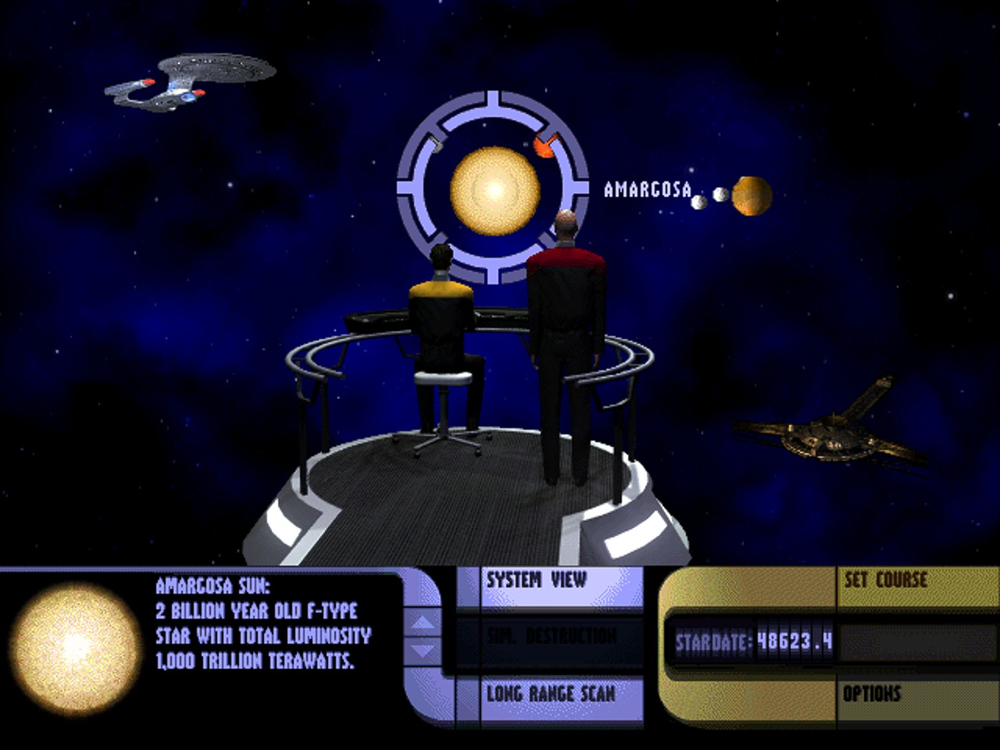
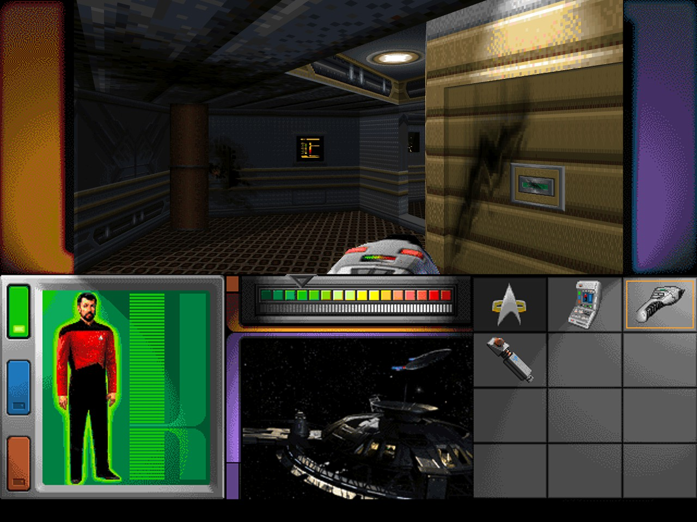
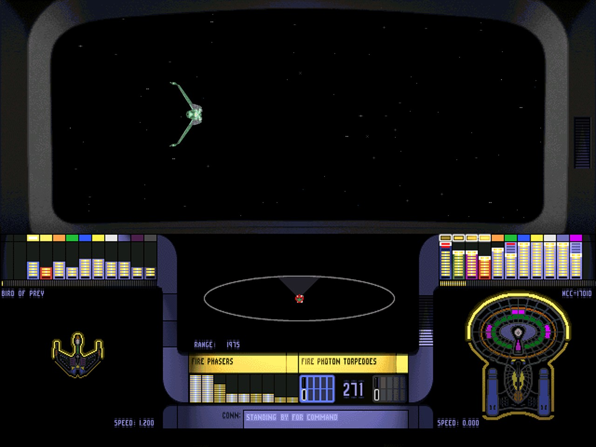
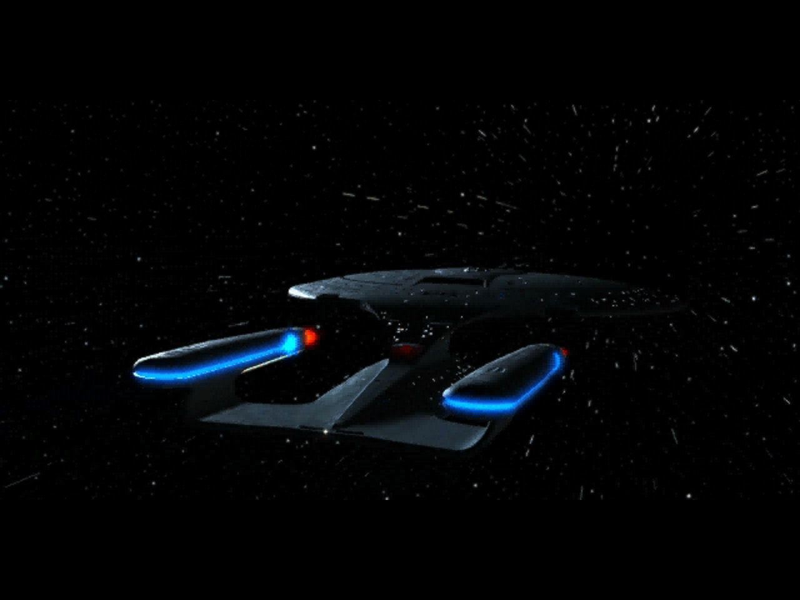
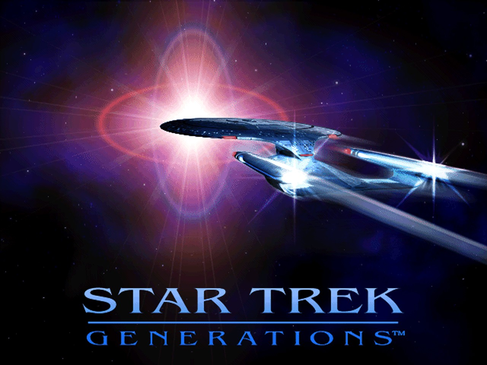
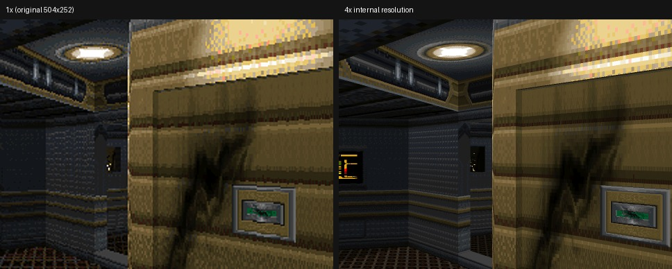

# Star Trek Generations – PC Native

A native port of *Star Trek Generations* (MicroProse, 1997) for modern Windows.
The game's own code (`sgens.exe`, MSVC 4.2 + MFC 4.2) is converted from x86 machine code to C by a static
recompiler and runs on a new runtime that replaces Windows 95, DirectDraw, DirectSound, DirectInput and
Video for Windows with code written for today's PCs. It doesn't use compatibility layers, wrappers or an emulator.

**This repository contains no game files.** You need your own copy of the game (the 2-CD version).



## Screenshots

| | |
|---|---|
|  |  |
| Away mission, 3D rendered at 4x | Space combat on the bridge viewscreen |
|  |  |
| Intro movie, full screen in full colour | Title |

### Internal resolution: the 3D is rendered again at up to 4x



Left: the original 504x252 away-mission view. Right: the same corridor rendered by the game's own 3D
engine at 4x (2016x1008). The HUD and pictures stay as drawn, while all 3D geometry gets the extra detail.

## What's new compared to the original

- **Real higher resolution for the 3D** – Video > Internal Resolution (3D): 1x–4x (4x default). The
  first-person away missions and the space combat viewscreen are rendered again at that size by the
  game's own engines, not just scaled up. Aiming (phasers, using things) follows the finer picture.
- **Movies in full colour, full screen** – the Cinepak movies are decoded in 24-bit colour by a new decoder
  instead of the 256-colour palette, and fill the screen. Both are options in the Video menu (on by default).
- **Space combat at the right speed** – the original lets combat run as fast as the PC can draw it, and on a
  modern PC that makes ships move about 2.4x too fast and the enemy AI shake. Frames are now paced to your
  display (60–120 fps), so the game clock stays in step with real time.
- **WASD** in away missions (alongside the arrow keys).
- **Presentation** – upscale filters (bicubic, nearest, bilinear, sharp bilinear, xBR), sharpening, FXAA,
  4:3 / stretch / integer scaling, any window size, Alt+Enter fullscreen.
- **Quality of life** – the wait for the briefing music to end before a mission can be skipped with a key or
  click; closing the game while it is busy no longer crashes it.

## Installing

No release yet – the port is still being tested. A setup that installs from your CDs or disc images is
in `installer/` and will be published under [Releases](../../releases) once testing is done.

**Options** (menu bar of the game window, or `generations.ini` next to the exe): Internal Resolution (3D)
1x–4x, Resolution, Aspect, Upscale Filter, Sharpening, FXAA, Movies in full colour, Movies fill the screen,
Fullscreen, Show FPS.

## Status

Work in progress (v0.1). Tested so far: intro and title movies, Stellar Cartography, briefings, the first
away mission (walking, scanning, phasers, transporting), space combat, the options screen.
Not tested yet: saving and loading, later missions, the whole story.

## Building

Windows Python 3 with capstone + Pillow, MSYS2 MINGW64 (gcc, SDL2), Ghidra only to remake the function list.

1. Put the installed game's `sgens.exe` (from `SUPP.Z` on CD 1; `tools/is3unz.py` unpacks it) in
   `gamedata/sgens.exe`.
2. Make the play folders: `game/hd/` = the installed game folder (`sgens.exe`, `sgens.ini`),
   `game/cd/GENS/` = the `GENS` folders of both CDs merged.

```bash
make gen                     # recompile sgens.exe -> src/gen/ (uses re/sgens/functions.tsv)
make -j8                     # build Generations.exe
./run_test.sh 30             # hidden, muted test run
```

Test switches: `STG_SHOT=ms;ms`, `STG_KEYS=ms:vk[:hold];…`, `STG_CLICK=x,y,ms;…`, `STG_RENDER=n`,
`STG_CAMLOG=1` (space combat ship log), `STG_FPSCAP=n`, `tools/teststart.py` to start straight in a
mission.

## Layout

| Path | What |
|---|---|
| `src/rt/` | the runtime: Win32 (kernel/user/GDI), guest threads as fibers, window manager for MFC, virtual memory |
| `src/rt/ddraw.c`, `dsound.c`, `dinput.c` | DirectDraw (8/16-bit), DirectSound (SDL), DirectInput mouse |
| `src/rt/vfw.c` | Video for Windows + own Cinepak decoder (full-colour movies) |
| `src/rt/hires_dre.c`, `hires_space.c` | the N x render of the away-mission engine and the space 3D library |
| `src/rt/present.c` | Direct3D 9 presenter, filters, Video menu, settings |
| `tools/recomp.py`, `tools/x86an.py`, `tools/pe.py` | x86 -> C recompiler, code analysis, PE loader |
| `tools/native_sgens.txt` | game functions wrapped by native C |
| `re/sgens/functions.tsv` | Ghidra's function list of `sgens.exe` |
| `installer/` | the setup (not released yet) |

Fan preservation project, not affiliated with Paramount, MicroProse or the game's publishers.
Star Trek and related marks are trademarks of their owners.
